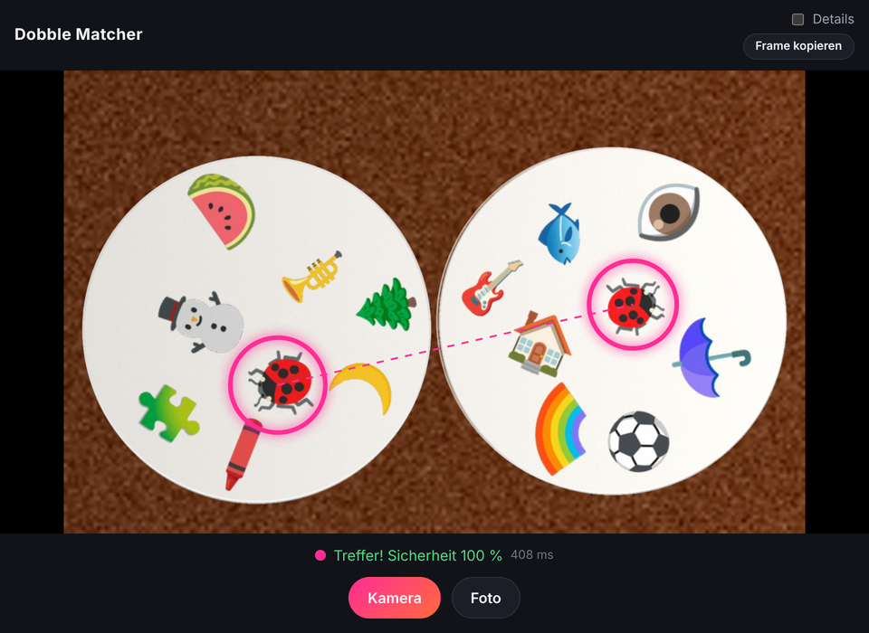

# tabletop-dobble

Web-App, die das gemeinsame Symbol zweier (oder mehrerer) Dobble-Karten findet – live über die Kamera oder per Foto. Läuft komplett im Browser mit [OpenCV.js](https://docs.opencv.org/4.12.0/d5/d10/tutorial_js_root.html) in einem Web Worker.

**▶ Live: [sebastiandeppisch.github.io/tabletop-dobble](https://sebastiandeppisch.github.io/tabletop-dobble/)**



<sub>Screenshot mit synthetischen Testkarten (`python3 scripts/generate_cards.py 8 out 2024 medium`).</sub>

## Pipeline

1. **Karten finden**: Weißanteil (`V − S` in HSV) per Otsu, Closing gegen Symbole am Kartenrand, Distanztransformation + Power-Diagramm trennt sich berührende Karten, Ellipsen-Fit nur auf dem äußeren Rand (robust gegen Überlappung und Perspektive).
2. **Keypoint-Matching (primär)**: ORB-Features pro Karte, kNN mit Ratio-Test, Farbcheck (Lab-Chroma um jeden Keypoint), danach eigene RANSAC für eine Ähnlichkeitstransformation in entzerrten Kartenkoordinaten inkl. Orientierungs-Check. Der größte kompakte Cluster ist das gemeinsame Symbol; die Sicherheit ergibt sich aus dem Abstand zum zweitbesten Cluster. Funktioniert auch, wenn sich Symbole berühren.
3. **Patch-Matching (Fallback)**: Symbole segmentieren (Helligkeit, Farbe, Kanten), auf Fläche normieren und in 36 Rotationen als 64×64-Patches vergleichen.

## Entwicklung

```bash
npm install
npm run dev      # Dev-Server
npm test         # Erkennung gegen tests/fixtures prüfen
npm run build    # Produktions-Build nach dist/
```

Testbilder erzeugen (synthetische Karten mit Noto-Emoji, Rotation, Licht-Gradient, Perspektive):

```bash
python3 scripts/generate_cards.py 24 tests/fixtures 42 mixed   # mixed | sparse | medium | dense
npx tsx scripts/eval.ts /tmp/set                               # Trefferquote + Laufzeit
npx tsx scripts/debug.ts /tmp/out tests/fixtures/*.jpg         # Overlays rendern
```

## Deployment

`.github/workflows/pages.yml` testet und baut bei jedem Push/PR und deployt `main` auf GitHub Pages.
Einmalig nötig: **Settings → Pages → Source: GitHub Actions**.
